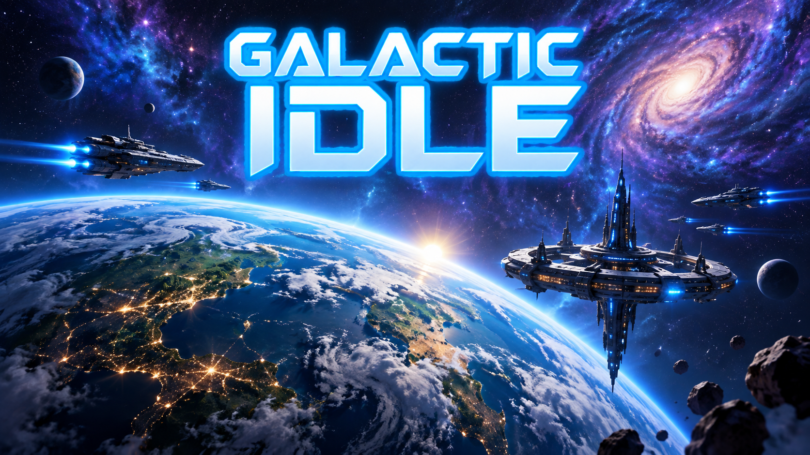

# RenderScribe Interactive

## Galactic Idle — a free idle 4X space strategy game for Android

**[▶ Get Galactic Idle on Google Play](https://play.google.com/store/apps/details?id=com.renderscribe.galacticidle&referrer=utm_source%3Dgithub%26utm_medium%3Dreadme%26utm_campaign%3Dsite)** · **[Website & trailer](https://renderscribe.github.io/galactic-idle/)**

Restore a dying colony's power grid, automate it with a growing web of
structures, and expand across a **20-planet galaxy** through military
conquest or diplomacy.

### Key features

- 5-resource economy with real offline progress
- 6-branch research tree with prerequisites
- Fleet building and tactical battles (or auto-resolve)
- Galaxy map with 20 planets and 5-faction diplomacy
- 17 expedition sectors with timed encounters
- 50 goals, doctrines, adaptive music and a lore timeline

Free to play, no pay-to-win mechanics.

### Links

- 🌐 Website: [renderscribe.github.io/galactic-idle](https://renderscribe.github.io/galactic-idle/)
- 📱 Google Play: [Galactic Idle](https://play.google.com/store/apps/details?id=com.renderscribe.galacticidle&referrer=utm_source%3Dgithub%26utm_medium%3Dreadme%26utm_campaign%3Dsite)
- 🔒 Privacy policy: [renderscribe.github.io/galactic-idle/privacy](https://renderscribe.github.io/galactic-idle/privacy/)

---

*RenderScribe Interactive is an independent game studio building Galactic Idle.*
